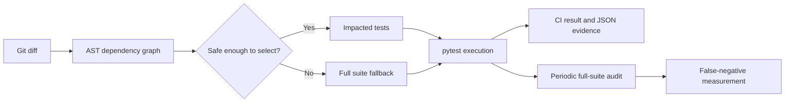

# AI x QE | Can AI Choose Which Tests to Run?

**A hands-on, reproducible lab in change-impact testing.** It demonstrates both the promise *and* the danger of intelligently reducing a regression suite. No paid LLM, cloud account, or API key required for the base experiment. A local Ollama integration is optional.

## The question

A developer changes one file. Must we run every test? We build a dependency-driven selector, then intentionally introduce a regression that it **misses**. A full audit catches the defect. A conservative selector refuses to skip tests when it sees a dynamic import.

### Architecture



## Quick start (Windows PowerShell / macOS / Linux)

You need Python 3.10+ and Git.

```bash
python -m venv .venv
# Windows PowerShell: .venv\Scripts\Activate.ps1
# macOS/Linux: source .venv/bin/activate
python -m pip install -e '.[dev]'
python -m pytest -q
python -m tools.demo
```

The demo creates a **temporary** application copy, injects a regression into `shop/risk.py`, runs selective and full testing, then cleans up automatically. It writes `reports/demo-results.json` into this repository. The original code is not modified.

Expected result (on the supplied project):
- Clean baseline: all tests pass.
- `fast` mode only selects `tests/test_risk.py`, and it **passes despite the injected regression**.
- `safe` mode detects runtime imports and falls back to full suite, which **fails**.
- Independently run full suite also **fails**, showing the false negative.

To inspect a file impact directly without requiring a Git repository:

```bash
python -m tools.selector --changed shop/cart.py --mode fast
python -m tools.run_selected
python -m tools.selector --changed shop/risk.py --mode safe
```

To select based on your actual Git changes (use an existing commit as the base):

```bash
python -m tools.selector --base HEAD~1 --worktree --mode safe
python -m tools.run_selected
```

The generated `reports/selection.json` records source changes, test files selected, total test files, the reason, and whether the full suite was chosen.

## Why the risk rule change slips through

`shop.checkout.place_order()` uses `import_module('shop.risk')`. Python's ordinary static `import` graph never links `shop.checkout` to `shop.risk`. So the optimistic selector runs only the direct risk test, which checks 100 and 500 but not the checkout rule at 750. The checkout integration test *would* catch the regression, but does not run. That's a **false negative**: a green selective run with a genuine production defect.

## Modes

| Mode | What it does | Appropriate use |
|------|--------------|-----------------|
| `fast` | Static import graph only, plus fail-open on unknown paths | Educational experiment; **not** a merge gate |
| `safe` (default) | Entire suite when any production change occurs and dynamic imports are found | CI demonstrator, conservatively safe for this lab |

**This is a learning prototype, not production-grade assurance.** `safe` may run everything frequently and cannot detect all dependency mechanisms. Real systems also need runtime coverage traces, data dependencies, generated files, test history, cross-service impact, risk policies, and full-suite audits. Code coverage alone does not prove defect detection.


## Optional AI advisor (runs locally, no cloud key)

The deterministic selector is the baseline. To add AI test suggestions, install [Ollama](https://ollama.com/), pull any local model capable of returning JSON, and start Ollama. For example:

```bash
ollama pull llama3.2
# Windows PowerShell: $env:OLLAMA_MODEL="llama3.2"
# macOS/Linux: export OLLAMA_MODEL=llama3.2
python -m tools.selector --changed shop/risk.py --mode fast --ai
python -m tools.run_selected
```

`--ai` sends changed source content and candidate test names to your **local** Ollama server on `127.0.0.1:11434`. The response is validated against known test paths. The model may **add** tests; it cannot remove graph-selected tests. If a requested AI advisor is unavailable, the selector falls back to the full suite. Model output is nondeterministic and the project makes **no guaranteed AI defect-detection claim**. Do not send confidential source code to an externally hosted Ollama server. The example connects only to localhost. Ollama's JSON response interface is described in its [API documentation](https://docs.ollama.com/api).

## CI

`.github/workflows/impact-tests.yml` uses read-only permissions, full Git history, and the conservative selector. PRs are compared to their base commit; normal pushes use the previous SHA. Manual dispatch includes a full audit. No secrets or third-party LLM execution.

GitHub Actions events and compare strategies vary with merge/rebase policies. For an initial/unknown compare, selector intentionally runs the full suite.

## The reader challenge

1. Make the `fast` selector catch this defect without always running every test.
2. Add runtime `coverage.py` contexts, or a declared `dynamic_dependencies.json` manifest.
3. Calculate precision, recall, miss rate, and time saved across 20 independent code changes. Compare against the full suite.
4. Add a rule that blocks a PR if a full-suite audit exposes a missed regression.

## Suggested metrics

- **Selection ratio:** number of test files selected / total test files.
- **Escaped-defect count:** failures detected by full audit, not detected by selected run.
- **False-negative rate:** escaped-defect cases / regression-bearing changes evaluated.
- **Savings:** full-suite execution time minus selective-test execution time, including selector overhead.

Don't report quality improvement from fewer executed tests alone. Measure both speed and missed defects.

## Project structure

```text
shop/                       small checkout domain (cart, price, risk, checkout)
tests/                      unit, integration, selector tests
tools/selector.py           static impact engine with safe/fast modes
tools/run_selected.py       execution stage
tools/demo.py               isolated injected-regression experiment
.github/workflows/          CI pipeline
reports/                    generated evidence (ignored by Git)
docs/NEWSLETTER.md          ready-to-edit long-form article
```

## License

MIT. This lab contains intentionally flawed experimental code in the demo mutation. Never use the risk rules to process real transactions.
